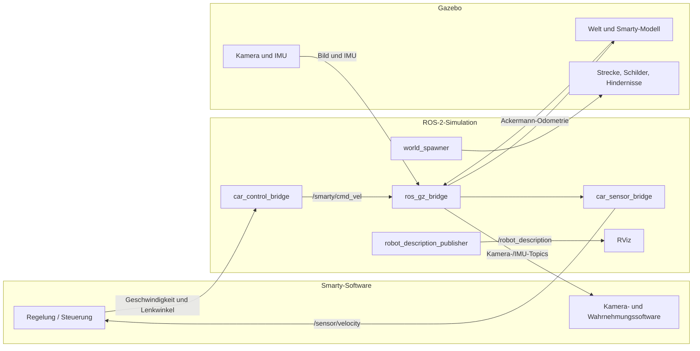

# Das Smarty-Simulationsprojekt – verständlich erklärt

Diese Seite führt dich vom großen Bild bis zu den wichtigsten Dateien. Du musst ROS 2 oder Gazebo nicht schon kennen: Die Begriffe werden unterwegs erklärt.

## In einem Satz

Das Paket `simulation` stellt Smarty als virtuelles Auto in Gazebo bereit, erzeugt eine befahrbare Strecke aus Python-Bausteinen und übersetzt Steuerbefehle sowie Sensordaten zwischen Gazebo und den ROS-2-Themen, die auch die übrige Smarty-Software verwendet.

## Das große Bild

**ROS 2** ist das Kommunikationssystem: Programme – sogenannte *Nodes* – tauschen Nachrichten über benannte Kanäle (*Topics*) aus. **Gazebo** berechnet die virtuelle Welt, die Bewegung und Sensoren. **RViz** zeigt ROS-Daten wie das Fahrzeugmodell und dessen Koordinatenrahmen an.



Die Pfeile zeigen die groben Datenwege. Die genaue Topic-zu-Gazebo-Zuordnung steht in [`config/ros_gz_bridge.yaml`](config/ros_gz_bridge.yaml); die ROS-Topics und Standardparameter sind in [`config/ros_params.yaml`](config/ros_params.yaml) konfiguriert.

## Was passiert beim Start?

Der Einstiegspunkt ist [`launch/simulation.launch.py`](launch/simulation.launch.py). Der Launch-Befehl startet nicht nur ein einzelnes Programm, sondern stellt mehrere Teile gemeinsam bereit:

1. Gazebo öffnet die Welt aus [`models/world.sdf`](models/world.sdf).
2. `ros_gz_bridge` verbindet ausgewählte Gazebo-Nachrichten mit ROS-2-Topics – und bei Steuerbefehlen auch in Gegenrichtung.
3. `robot_description_publisher` veröffentlicht das Fahrzeugmodell auf `/robot_description`, damit ROS-Werkzeuge es darstellen können.
4. `car_control_bridge` nimmt Smarty-Steuerwerte entgegen und sendet sie an Gazebo.
5. `car_sensor_bridge` leitet die simulierte Fahrzeuggeschwindigkeit als einfaches ROS-Thema weiter.
6. `world_spawner` lädt die konfigurierte Strecke und fügt Straßenfläche, Schilder und Hindernisse in die Gazebo-Welt ein.
7. RViz wird standardmäßig geöffnet. Eine optionale Tastatursteuerung lässt sich beim Start einschalten.

Die wesentlichen Startparameter und Defaults sind direkt im Launchfile aufgeführt. Die Nodes erhalten außerdem die Werte aus `ros_params.yaml`.

## Wie bewegt sich das virtuelle Auto?

Die Regelung oder ein anderer ROS-Node veröffentlicht Steuerwerte. Der Control-Bridge-Node liest sie ein und veröffentlicht regelmäßig eine `Twist`-Nachricht auf `/smarty/cmd_vel`. `ros_gz_bridge` übersetzt diese Nachricht für das Ackermann-Lenkungsmodell von Gazebo. Ackermann-Lenkung ist das Prinzip eines Autos: Die Vorderräder lenken, während die Hinterräder nicht seitlich angetrieben werden.

```text
/control/velocity/target       ─┐
                                ├─> car_control_bridge
/control/steering_angle/target ─┘        │
                                         v
                                  /smarty/cmd_vel
                                         │ ros_gz_bridge
                                         v
                                 Gazebo-Ackermann-Modell
```

Für die Rückrichtung veröffentlicht Gazebo Odometrie – also geschätzte Position, Orientierung und Bewegung. Der Bridge-Node `car_sensor_bridge` liest daraus die Vorwärtsgeschwindigkeit und veröffentlicht sie als `Float32` auf `/sensor/velocity`.

| ROS-Topic | Zweck im Simulationspaket |
|---|---|
| `/control/velocity/target` | Gewünschte Geschwindigkeit für das Fahrzeug |
| `/control/steering_angle/target` | Gewünschter Lenkwinkel |
| `/smarty/cmd_vel` | Zusammengefasster Bewegungsbefehl an Gazebo |
| `/smarty/odometry/ackermann` | Ackermann-Odometrie aus Gazebo |
| `/sensor/velocity` | Vorwärtsgeschwindigkeit als einfacher Zahlenwert |
| `/camera/image/raw` | Simuliertes Kamerabild |
| `/camera/camera/info` | Kamerainformationen |
| `/sensor/imu` | Simulierte IMU-Daten |
| `/clock` | Simulationszeit für ROS 2 |

Die Kamera und IMU sind im Fahrzeugmodell [`models/smarty/model.sdf`](models/smarty/model.sdf) beschrieben. Das Paket stellt ihre Gazebo-Sensordaten über die Bridge bereit; Bildverarbeitung und Wahrnehmung sind Aufgabe anderer Pakete.

## Wie entsteht die Strecke?

Die Strecke ist keine fest modellierte Geometrie in `world.sdf`. Stattdessen ist sie als Python-Programm definiert, standardmäßig in [`models/roads/default_road/road.py`](models/roads/default_road/road.py).

- `Road` ist der Strecken-Container.
- `StraightRoad`, `LeftCircularArc`, `Intersection` und weitere Klassen sind Streckenabschnitte.
- Beim Anhängen eines Abschnitts übernimmt dieser die Endposition und Ausrichtung des vorherigen Abschnitts. So baut sich die Strecke Abschnitt für Abschnitt zusammen.
- Abschnitte können zusätzlich Markierungen, Tempolimits, Parkbereiche, Schilder oder Hindernisse enthalten.
- `world_spawner` lädt das Road-Programm. Der Road-Renderer zeichnet die Straßenoberfläche samt Markierungen in ein Bild; Gazebo verwendet dieses Bild als Textur einer Fläche. Schilder und Hindernisse werden zusätzlich als eigene Modelle erzeugt.

Damit ist die Straße bewusst leicht veränderbar: Für einen neuen Verlauf bearbeitest oder ergänzt du ein Road-Programm und wählst es über den Parameter `world_spawner.road` in `config/ros_params.yaml` aus.

## Wo finde ich was?

| Pfad | Aufgabe |
|---|---|
| [`launch/simulation.launch.py`](launch/simulation.launch.py) | Startet Gazebo, ROS-Nodes, Bridge und optional RViz/Tastatursteuerung |
| [`config/ros_params.yaml`](config/ros_params.yaml) | Wählbare Road-Datei, Modellpfade, Topic-Namen und Node-Parameter |
| [`config/ros_gz_bridge.yaml`](config/ros_gz_bridge.yaml) | Zuordnung zwischen ROS-Topics und Gazebo-Topics samt Nachrichtenrichtung |
| [`models/world.sdf`](models/world.sdf) | Gazebo-Welt, Physik, Beleuchtung und Fahrzeug-Plugins |
| [`models/smarty/model.sdf`](models/smarty/model.sdf) | Fahrzeugkörper, Räder, Sensoren und Modellgeometrie |
| [`models/roads/`](models/roads/) | Python-Definitionen der Strecken |
| [`simulation/car_control_bridge.py`](simulation/car_control_bridge.py) | Übersetzt Steuer-Topics in den Gazebo-Fahrbefehl |
| [`simulation/car_sensor_bridge.py`](simulation/car_sensor_bridge.py) | Leitet Geschwindigkeit aus der Gazebo-Odometrie weiter |
| [`simulation/world_spawner.py`](simulation/world_spawner.py) | Erzeugt Straße, Schilder und Hindernisse in Gazebo |
| [`simulation/robot_description_publisher.py`](simulation/robot_description_publisher.py) | Veröffentlicht das Fahrzeugmodell für ROS-Werkzeuge |
| [`simulation/groundtruth/road/`](simulation/groundtruth/road/) | Geometrie, Streckenabschnitte und Renderer |
| [`test/`](test/) | Pakettests und Stil-/Copyright-Prüfungen |

## Starten und ausprobieren

Voraussetzung ist eine eingerichtete Smarty-ROS-2-Umgebung. Aus dem Workspace:

```bash
make build PKG=simulation
source install/setup.bash
ros2 launch simulation simulation.launch.py
```

Mit Tastatursteuerung:

```bash
ros2 launch simulation simulation.launch.py keyboard_control:=true
```

W/A/S/D oder die Pfeiltasten steuern Geschwindigkeit und Lenkung. Die Tastatursteuerung veröffentlicht auf denselben Steuerungs-Topics wie andere Steuerungs-Nodes. Aktiviere sie deshalb **nicht gleichzeitig mit einer autonomen Regelung**, sonst senden mehrere Quellen konkurrierende Befehle.

Zum Testen der übrigen Smarty-Software kann die Simulation als Ersatz für das reale Fahrzeug gestartet werden. Die dafür nötigen weiteren Nodes – etwa Kamera-Vorverarbeitung, Fahrspurerkennung und Pfadplanung – gehören zu separaten Paketen und werden nicht alle von `simulation.launch.py` gestartet. Das Workspace-Skript [`all.launch.sh`](../all.launch.sh) startet die Simulation zusammen mit mehreren dieser Pakete.

## Nützliche Hinweise beim Debuggen

- **Topic-Namen zuerst in `config/ros_params.yaml` nachsehen.** Einige Defaultwerte im Python-Code sind älter als die Konfiguration. Zum Beispiel verwendet der Control-Bridge-Code als Fallback `/control/steering/target`, während der Launch mit der Parameterdatei `/control/steering_angle/target` konfiguriert.
- Mit `ros2 topic list` siehst du verfügbare Topics; mit `ros2 topic echo /sensor/velocity` kannst du beispielsweise die Geschwindigkeit beobachten.
- Gibt es keine Bewegung, prüfe zuerst, ob Befehle auf `/control/velocity/target` und `/control/steering_angle/target` ankommen und ob danach `/smarty/cmd_vel` veröffentlicht wird.
- Für Sensoren führt der Weg von Gazebo über `ros_gz_bridge`. Prüfe deshalb sowohl die Gazebo-Seite als auch die ROS-Topic-Zuordnung in `ros_gz_bridge.yaml`.
- Die Simulation kann je nach Rechner deutlich langsamer als Echtzeit laufen. Das Verhältnis wird in der Gazebo-Ansicht angezeigt; eine niedrige Rate bedeutet, dass Simulationszeit langsamer voranschreitet.
- Wird das Modell in RViz nicht angezeigt, prüfe `/robot_description` sowie die Modell- und Mesh-Pfade unter `models/`.

## Ein gutes mentales Modell

Wenn du im Projekt etwas ändern willst, frage dich zuerst:

1. **Ändere ich die Welt oder das Auto?** Dann sind `models/` und SDF-Dateien relevant.
2. **Ändere ich den Streckenverlauf?** Dann ist die Python-Road-Definition und gegebenenfalls `world_spawner.road` relevant.
3. **Ändere ich Nachrichten zwischen Gazebo und ROS?** Dann gehören die Zuordnung und Richtung in `config/ros_gz_bridge.yaml`.
4. **Ändere ich einen Smarty-Eingang oder -Ausgang?** Dann prüfe die ROS-Topics in `ros_params.yaml` und den passenden Bridge-Node.
5. **Ändere ich die Startzusammenstellung?** Dann ist `launch/simulation.launch.py` der zentrale Einstiegspunkt.

So lässt sich das Projekt in drei Schichten lesen: **Gazebo-Modell und Welt**, **ROS-2-Bridge-Nodes und Topics**, **Smarty-Software, die mit diesen Topics arbeitet**.
